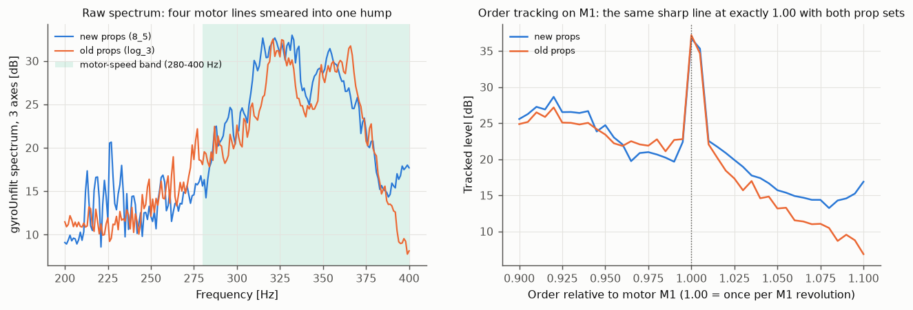
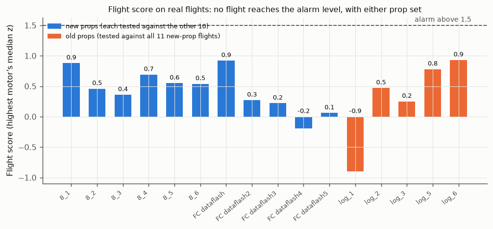
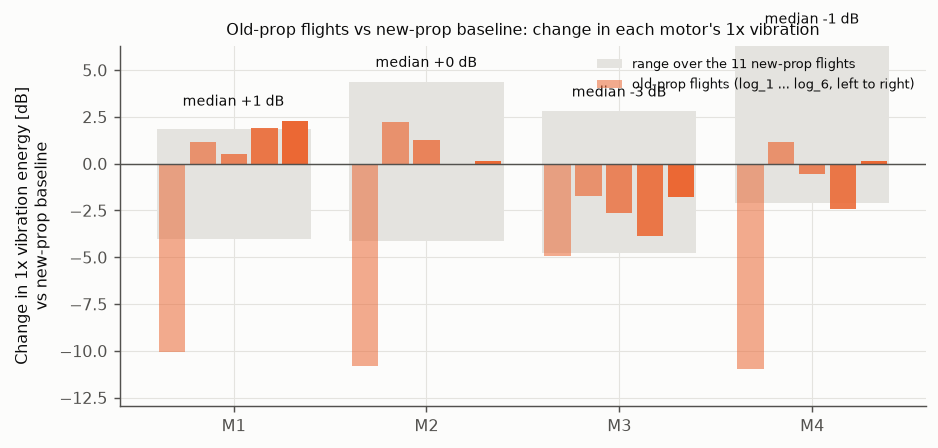
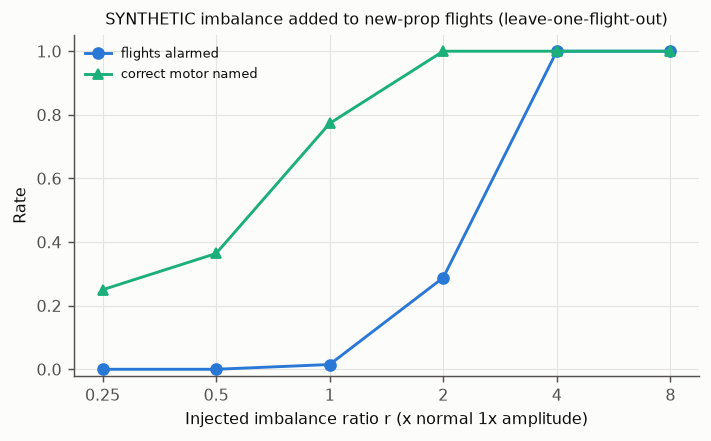

# Propeller fault monitoring on a BETAFPV AIR75, signal processing only

One drone, our own Betaflight blackbox logs, and **no AI/ML**: only signal processing and simple
statistics (median, MAD, percentile). Libraries: numpy, scipy, pandas, matplotlib.

**Idea.** An unbalanced or damaged propeller shakes the drone once per revolution of its motor.
Each motor reports its speed (eRPM), so we can pull that motor's once-per-revolution ("1×")
vibration out of the gyro and compare it with what is normal for that motor.

## Results in short

| Question | Result | Data |
|---|---|---|
| Can each motor's 1× vibration be isolated? | Yes, a sharp line at exactly the motor's speed | real |
| Do Betaflight's filters hide it? | Yes, it is 24–43 dB weaker in `gyroADC` than in `gyroUnfilt` | real |
| False alarms, new props (baseline) | 0 of 11 flights | real |
| Check: old-prop flights against the new-prop baseline | 0 of 5 flights alarm; every motor within the normal range | real |
| Which motor vibrates most? | M1, in all 16 flights, by 6–14 dB over the next motor | real |
| Detection of an added imbalance | 100 % at 4× the normal level (+12 dB); 29 % at 2× (+7 dB) | SYNTHETIC |
| Localization of the added imbalance | 100 % at 2× and above; 77 % at 1× (chance 25 %) | SYNTHETIC |
| Severity of the added imbalance | within 0.3–0.4 dB from 2× upward | SYNTHETIC |

**What this means.** The monitor works on real flights and does not false-alarm. The old
propellers do **not** show up as faulty: their flights look the same as the new-prop flights. So
there is no real fault in this data, and detection, localization and severity of a fault are
shown only with a synthetic imbalance.

## Data

Blackbox CSVs from `~/real_data/sessions` (craft "AIR75 R", Betaflight 2026.6, 12-pole motors,
bidirectional DShot). `flight_labels.csv` records which propeller set each flight used; all four
propellers were replaced between the two sets (pilot's record).

| Props | Files | Log rate | Flights | In-flight 1 s windows |
|---|---|---|---|---|
| new (baseline) | `8_1`…`8_6`, `FC dataflash`, `FC dataflash2`…`5` | 808 Hz | 11 | 724 |
| old (check) | `log_1`, `log_2`, `log_3`, `log_5`, `log_6` | 3.2 kHz | 5 | 284 |

Not used: `log_4` and `flight5` (byte-identical copies), and everything in `~/drone_aruco` (ArUco
tracking logs at about 30 Hz with no gyro or motor speed).

## Method

1. **Motor speed.** Rotation frequency = eRPM × 100 / 6 / 60 Hz. In flight the motors run at
   about 300–370 Hz.
2. **Order tracking.** Integrating a motor's speed over time gives its shaft angle θ(t). For each
   1 s slice, `X = Σ w·x·exp(−jθ) / Σ w` gives the part of the gyro signal that is in step with
   that motor (roll, pitch and yaw combined). Result: one 1× level per motor per second.
3. **Baseline.** Median and MAD of each motor's 1× level (dB) over the baseline flights.
4. **Score.** `z = (level − median) / (1.4826·MAD)` per motor and window.
5. **Detection.** A flight alarms if any motor's median z over the flight exceeds 1.5.
6. **Localization.** The motor with the highest flight-median z.
7. **Severity.** Change in that motor's 1× energy versus baseline: `10·log10(median A² / baseline median A²)` dB.

New-prop flights are tested leave-one-flight-out (each against the other ten). Old-prop flights
are tested against all eleven new-prop flights.

## Filters used, and where

**In our code**

| Filter | Where | Purpose |
|---|---|---|
| Mean removal | `src/order_tracking.py`, every 1 s slice | Removes slow drone motion before tracking |
| Tracking band-pass (multiply by `exp(−jθ)`, then average) | `src/order_tracking.py`, `tracked_orders` | Keeps only what is within about 2 Hz of one motor's speed and follows that speed as it changes |
| Hann window, 1 s, 50 % overlap | same function | Sharpens the tracking filter so neighbouring motors leak in less |
| Median and MAD | `src/monitor.py` | Robust "normal level" and flight score; ignores outlier slices |
| Fourier spectrum on true sample times | `src/order_tracking.py`, `spectrum_true_time` | Raw spectrum for plots and the band-energy comparison |
| Spectrogram, Welch averaging | `src/figures.py` | Plots only |

We apply no low-pass or notch filter of our own.

**Inside Betaflight** (these produce `gyroADC`; we bypass them by reading `gyroUnfilt`)

| Filter | Setting in these logs | Effect |
|---|---|---|
| RPM filter | notches at 1×, 2×, 3× of each motor's speed | Removes motor vibration |
| Dynamic notch | 2 notches, 100–400 Hz | Removes the strongest remaining peaks |
| Gyro low-pass 2 | 550 Hz (low-pass 1 off) | Removes high-frequency noise |

Measured effect: the tracked 1× line is 24–43 dB weaker in `gyroADC` (median 31 dB on the new-prop
flights, 34 dB on the old-prop flights). A propeller monitor has to read `gyroUnfilt`.

## Results

### 1. Each motor's 1× vibration (real)


Flight-median 1× level, all 16 flights (`results/tables/order_levels_by_flight.md`):

| | M1 | M2 | M3 | M4 |
|---|---|---|---|---|
| Median | 36.9 dB | 26.2 dB | 22.4 dB | 23.6 dB |
| Range without `log_1` | 33–39 | 22–30 | 20–26 | 22–31 |

M1 is the strongest motor in every flight, 6–14 dB above the next one, with both propeller sets.
Because it survived a full propeller change, the propeller is unlikely to be the cause; the motor
itself or how its vibration reaches the gyro are possible, but we have not tested either.
`log_1` is 3–11 dB quieter on every motor than the other flights.



Left: in the raw spectrum the four motor lines merge into one hump, and the plain energy in that
band is the same for both sets (38–44 dB). Right: order tracking resolves M1's line.

### 2. Diagnosis of every flight (real)



Full table: `results/tables/diagnosis_per_flight.md`. Summary (`detection_summary.md`):

| | Alarm | No alarm | Flight score range |
|---|---|---|---|
| New props, 11 flights | 0 | 11 | −0.2 to 0.9 |
| Old props, 5 flights | 0 | 5 | −0.9 to 0.9 |



Median change of the old-prop flights versus the new-prop baseline: M1 +1.1 dB, M2 +0.1 dB,
M3 −2.6 dB, M4 −0.5 dB. New-prop flights themselves vary from −4.8 to +6.7 dB, so this is no
difference. The result is the same when the old-prop logs are cut down to 808 Hz (no alarms; M1
reading changes by at most 0.4 dB), so the different log rates are not hiding anything.

### 3. Synthetic imbalance (SYNTHETIC, on the new-prop flights)

A rotating 1× tone, growing with speed squared, is added to the real gyro data of one motor.
r = added amplitude / that motor's normal 1× amplitude. 132 cases per row
(`results/tables/synthetic_by_size.md`).

| r | Injected increase | Flights alarmed | Correct motor | Measured increase |
|---|---|---|---|---|
| 0.25 | +0.3 dB | 0 % | 25 % | +0.4 dB |
| 0.5 | +1.0 dB | 0 % | 36 % | +1.2 dB |
| 1 | +3.0 dB | 2 % | 77 % | +3.1 dB |
| 2 | +7.0 dB | 29 % | 100 % | +7.0 dB |
| 4 | +12.3 dB | 100 % | 100 % | +12.3 dB |
| 8 | +18.1 dB | 100 % | 100 % | +18.1 dB |



Other figures: `synthetic_example.png`, `synthetic_localization_confusion_r2.png`,
`synthetic_severity_estimate.png`, `spectrogram_erpm_tracks.png`,
`betaflight_unfilt_vs_filtered_psd.png`.

### 4. Screening of the older raw logs (real, not part of the numbers above)

`survey_logs.py` runs the same tracking on the 78 logs in the two raw `.BBL` files (1 Sept and
15 Sept), decoded with `blackbox_decode`. Table: `results/tables/extra_logs_survey.md`.

* 45 logs are under 4 s and 20 have under about 5 s airborne (arming tests, hops, crashes).
* In the 13 logs with real airborne time: no alarm in the five that fly in the baseline's speed
  range, no sudden motor-speed drops, and motor 4 is never the odd one out (its 1× level is
  between 5 dB below and 2 dB above the other motors; its command-per-speed is within 11 % of
  the average).

## Limitations

* **No real fault in the data.** Fault detection, localization and severity are shown only with a
  synthetic 1× tone, which is the same kind of signal the detector looks for. The real part of
  that test is the noise, the speed profiles and the four interfering motors.
* **The alarm level 1.5 was chosen after looking at these flights** (largest real score 0.9).
* **The old propellers' condition was not inspected.** We can only say they do not differ
  measurably in 1× vibration from the new ones.
* **808 Hz logs are unevenly sampled** (about 1 step in 26 is half-length). All processing uses
  each frame's own timestamp. An earlier version assumed even sampling, which mis-tuned the
  tracker on those logs.
* One drone, 16 short flights, one gyro at the centre of the frame. Motor faults are not covered.

**To validate for real:** fly a hover with one deliberately chipped propeller on a known motor,
log at 3.2 kHz with `gyroUnfilt` and eRPM, add the file to `flight_labels.csv`, and re-run.

## How to run

```bash
python3 -m venv .venv && .venv/bin/pip install -r requirements.txt
# copy the 16 CSVs listed in flight_labels.csv into data/air75/
.venv/bin/python -I run_all.py        # about 20 s
# optional: screen extra logs decoded from a .BBL (blackbox_decode from betaflight/blackbox-tools)
.venv/bin/python -I survey_logs.py <folder of decoded CSVs>
```

Code: `src/bblog.py` (loader), `src/order_tracking.py`, `src/monitor.py`, `src/inject.py`
(synthetic imbalance), `src/pipeline.py` (windowing, evaluation), `src/figures.py`, `run_all.py`, `survey_logs.py`.
Outputs: `results/tables`, `results/figures`, `results/summary.json`.
