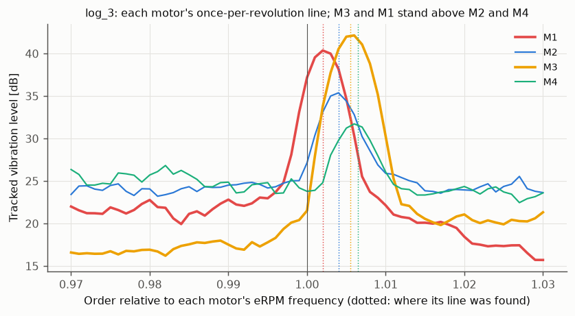
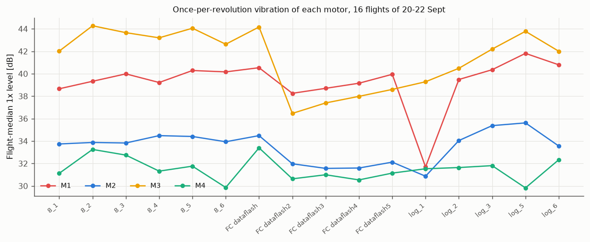
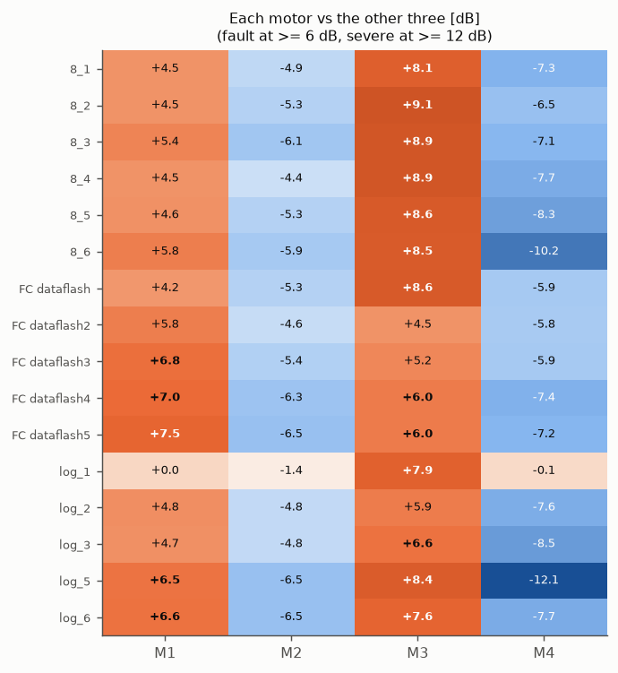
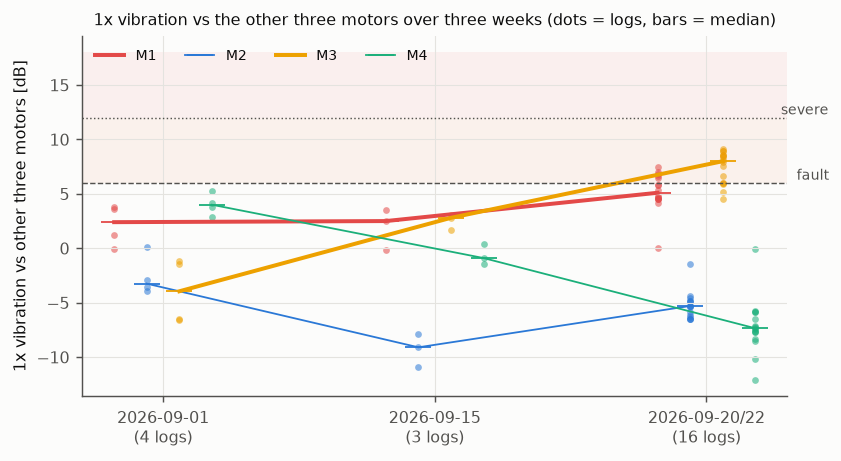
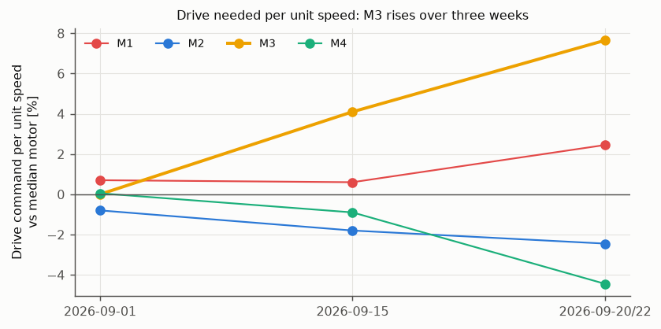

# Propeller and motor fault diagnosis on a BETAFPV AIR75, signal processing only

One drone, our own Betaflight blackbox logs, and **no AI/ML**: only signal processing (order
tracking, spectra) and plain statistics (median). Libraries: numpy, scipy, pandas, matplotlib.

## Diagnosis

| Motor | Verdict | 1× vibration vs the other three motors (20–22 Sept, 16 flights) | Flights over the fault level | Other evidence |
|---|---|---|---|---|
| **M3** | **Fault** | **+8.0 dB** (4.5 to 9.1) | **13 / 16** | Needs 4–11 % more drive per unit speed than the other motors and is the slowest motor in 14 of 16 flights; both grew over three weeks |
| **M1** | **Fault, early stage** | **+5.1 dB** (0.0 to 7.5) | **5 / 16** | One of the two highest-vibration motors in all 16 flights; rose from +2.4 dB on 1 Sept |
| M2 | Normal | −5.3 dB | 0 / 16 | – |
| M4 | Normal | −7.3 dB | 0 / 16 | – |

**Why M3.** Its once-per-revolution ("1×") vibration is the strongest of the four motors in 12 of
16 flights, about 2.5 times the amplitude of the median motor. It is at or above the fault level in
13 flights and 77 % of all 1-second windows. Over three weeks it went from below the other motors
(−4.0 dB on 1 Sept) to +2.8 dB (15 Sept) to +8.0 dB (20–22 Sept). Over the same period M3 needed
progressively more drive command for the same speed (+0 %, +4 %, +8 %) while settling at the lowest
speed of the four. A once-per-revolution vibration comes from an imbalance in the rotating parts
(propeller or motor bell), and extra drive for less speed means extra load on that rotor. Together
these point to damage on M3's propeller, which adds both imbalance and drag.

**Why M1.** Its 1× vibration is one of the two highest in all 16 flights (highest in 4, second in
12), at a median of +5.1 dB
(about 1.8 times the amplitude of the median motor). It crosses the 6 dB fault level in 5 flights
and in 37 % of all windows. It rose from +2.4 dB (1 Sept) and +2.5 dB (15 Sept) to +5.1 dB (20–22
Sept). This is the same imbalance signature as M3, at an earlier stage.

**Recommended action:** inspect and replace the propellers on M3 and M1 first, then check both
motor bells for play.

## How it works, in short

Each motor reports its speed (eRPM). An unbalanced or damaged rotor shakes the drone once per
revolution. Using each motor's own speed, we pull that motor's 1× vibration out of the gyro signal,
then compare each motor with the other three. The four motors are identical, so a motor that
shakes much more than its siblings is the faulty one.

## Data

Betaflight blackbox logs of the AIR75 ("AIR75 R", Betaflight 2026.6, 12-pole motors, bidirectional
DShot). Table: `results/tables/logs_inventory.md`.

| Date | Source | Logs | Used |
|---|---|---|---|
| 2026-09-20/22 | CSV exports `log_1`…`log_6`, `8_1`…`8_6`, `FC dataflash`…`FC dataflash5` (3.2 kHz and 808 Hz) | 18 | 16 (two are byte-identical copies) |
| 2026-09-15 | raw `.BBL`, decoded with `blackbox_decode` (3.2 kHz) | 13 | 3 with at least 10 s airborne |
| 2026-09-01 | raw `.BBL`, decoded with `blackbox_decode` (808 Hz) | 65 | 4 with at least 10 s airborne |

The 20–22 Sept flights are the main dataset. The two earlier dates give the trend.

## Method

1. **Motor speed.** Rotation frequency = eRPM × 100 / 6 / 60 Hz (12 poles). In hover the
   motors run at about 300–370 Hz.
2. **Order tracking** (`src/order_tracking.py`). Integrating a motor's speed over each sample's real
   timestamp gives its shaft angle θ(t). For each 1-second slice (Hann window, 50 % overlap),
   `X = Σ w·x·exp(−j·θ) / Σ w` gives the part of the gyro signal (roll, pitch and yaw combined) that
   is in step with that motor. This follows the motor as its speed changes, and keeps the four
   motors apart even though they all run in the same frequency band.
3. **Line location** (`src/pipeline.py`). Each motor's 1× line sits slightly above the frequency
   computed from its eRPM telemetry: by about 0.2 % for M1, 0.4 % for M2 and 0.6 % for M3 and M4
   (0.7–2.3 Hz), and the same in every flight. With 1-second windows that is enough to miss most
   of a line. So per flight and motor we first find where the line actually peaks (search ±3 Hz)
   and track it there.
4. **Peer comparison** (`src/monitor.py`). For each motor and slice:
   `peer_delta = level − median(level of the other three)` in dB. Speed, throttle, battery and
   manoeuvres change all four motors together and cancel out of this difference; a fault on one
   motor does not.
5. **Detection.** A motor is flagged in a flight when its flight-median `peer_delta` is at least
   **6 dB** (twice the vibration amplitude of the other motors). **12 dB** (four times) is graded
   severe.
6. **Localization.** The flagged motor or motors.
7. **Severity.** The flight-median `peer_delta` in dB.
8. **Load check.** Drive command per unit speed for each motor, relative to the median motor, and
   each motor's speed relative to the median motor.

## Filters used, and where

**In our code**

| Filter | Where | Purpose |
|---|---|---|
| Mean removal | `src/order_tracking.py`, every 1 s slice | Removes slow drone motion before tracking |
| Tracking band-pass (multiply by `exp(−jθ)`, then average) | `src/order_tracking.py`, `tracked_orders` | Keeps only what is within about 2 Hz of one motor's speed, following that speed as it changes |
| Hann window, 1 s, 50 % overlap | same function | Sharpens the tracking filter so neighbouring motors leak in less |
| Line search, ±3 Hz | `src/pipeline.py`, `locate_lines` | Centres the tracking filter on each motor's actual line |
| Median over slices and over the other motors | `src/monitor.py` | Robust levels; ignores outlier slices |
| Spectrogram, Welch averaging | `src/figures.py` | Plots only |

We apply no low-pass or notch filter of our own.

**Inside Betaflight** (these produce `gyroADC`; we bypass them by reading `gyroUnfilt`)

| Filter | Setting in these logs | Effect |
|---|---|---|
| RPM filter | notches at 1×, 2×, 3× of each motor's speed | Removes motor vibration |
| Dynamic notch | 2 notches, 100–400 Hz | Removes the strongest remaining peaks |
| Gyro low-pass 2 | 550 Hz (low-pass 1 off) | Removes high-frequency noise |

Measured effect: each motor's 1× line is **33–49 dB weaker** in `gyroADC` than in `gyroUnfilt`
(median 39 dB). The flight controller's filters remove exactly the signal a fault monitor needs, so
the monitor must read `gyroUnfilt`.

## Results

### 1. Each motor's 1× vibration line



One flight (`log_3`): each motor's tracked vibration around its own rotation frequency. M3's and
M1's lines are clearly higher than M2's and M4's. Spectrogram with the four motor tracks:
`results/figures/spectrogram_erpm_tracks.png`.

Flight-median 1× level, 16 flights (`results/tables/order_levels_by_flight.md`):

| | M1 | M2 | M3 | M4 |
|---|---|---|---|---|
| Median | 39.7 dB | 33.8 dB | 42.1 dB | 31.4 dB |
| Range | 31.7–41.8 | 30.9–35.6 | 36.5–44.3 | 29.8–33.4 |



### 2. Diagnosis per flight



Tables: `results/tables/diagnosis_per_flight.md`, `diagnosis_summary.md`.

| Motor | Flights flagged | Median | Range | Windows at fault level (median) |
|---|---|---|---|---|
| M1 | 5 / 16 | +5.1 dB | 0.0 to 7.5 | 37 % |
| M2 | 0 / 16 | −5.3 dB | −6.5 to −1.4 | – |
| M3 | 13 / 16 | +8.0 dB | 4.5 to 9.1 | 77 % |
| M4 | 0 / 16 | −7.3 dB | −12.1 to −0.1 | – |

M2 and M4 never rise above −0.1 dB in any flight, far below the 6 dB fault level.

### 3. Trend over three weeks



`results/tables/trend_by_date.md` (median over the logs of each date):

| Date | Logs | M1 | M2 | M3 | M4 |
|---|---|---|---|---|---|
| 2026-09-01 | 4 | +2.4 dB | −3.3 dB | −4.0 dB | +4.0 dB |
| 2026-09-15 | 3 | +2.5 dB | −9.1 dB | +2.8 dB | −0.9 dB |
| 2026-09-20/22 | 16 | +5.1 dB | −5.3 dB | +8.0 dB | −7.4 dB |

On 1 Sept no motor reached the fault level. M3 rose by 12 dB over the three weeks, and M1 by 2.7 dB.

### 4. Motor load



`results/tables/drive_and_speed_by_date.md`:

| Date | M3 drive per unit speed vs median motor | M3 speed vs median motor |
|---|---|---|
| 2026-09-01 | +0.0 % | +6.1 Hz |
| 2026-09-15 | +4.1 % | −1.6 Hz |
| 2026-09-20/22 | +7.6 % | −16.4 Hz |

In the 16 main flights M3 needs the most drive per unit speed in every flight (+4 % to +11 %) and is
the slowest motor in 14.

### 5. Checks

* **Log rate.** Two-thirds of the main flights were logged at 808 Hz instead of 3.2 kHz. Cutting
  the 3.2 kHz flights down to 808 Hz changes M1's peer value by at most 0.2 dB
  (`results/tables/log_rate_check.md`).
* **Window length.** With 2-second slices instead of 1-second ones the per-motor medians are
  M1 +5.5, M2 −5.3, M3 +8.3, M4 −7.6 dB: the same diagnosis.
* **Sampling.** The 808 Hz logs are not evenly sampled (about 1 step in 26 is half-length), so all
  processing uses each sample's own timestamp.

## Limitations

* One drone, 23 usable logs, about 11 minutes airborne. Thresholds (6 and 12 dB) are fixed
  engineering levels (two and four times the amplitude of the other motors), not fitted to data.
* A single gyro at the centre of the frame: motors are told apart only by their speed, and a
  motor's distance from the gyro can change its measured level. The trend over dates and the
  load data are independent of this.
* The 1× signature shows an imbalance in a rotating part. From the logs alone a damaged
  propeller and an unbalanced motor bell look the same; the load data on M3 points to the
  propeller.
* Motor bearing and winding faults have other signatures (non-integer frequencies, electrical
  sidebands) that this method does not look for.

## How to run

```bash
python3 -m venv .venv && .venv/bin/pip install -r requirements.txt
# 1. main logs: copy the blackbox CSVs (log_1 ... log_6, 8_1 ... 8_6, FC dataflash*) into data/air75/
# 2. optional, for the trend: decode the raw .BBL files with blackbox_decode
#    (github.com/betaflight/blackbox-tools) into data/bbl/<YYYY-MM-DD>/
.venv/bin/python -I run_all.py        # about 20 s
```

The flight logs are not in the repository (`data/` is git-ignored).

Code: `src/bblog.py` (log loader), `src/order_tracking.py` (eRPM order tracking),
`src/pipeline.py` (windowing, line location), `src/monitor.py` (peer comparison, detection,
severity), `src/figures.py`, `run_all.py`. Outputs: `results/tables`, `results/figures`,
`results/summary.json`.
